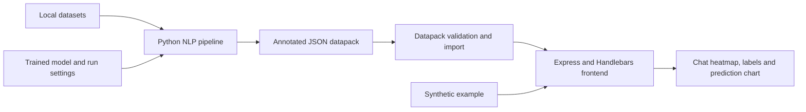

# NLP chat analysis and visualisation

A dissertation project exploring early detection of concerning behaviour in chat communications. A Python NLP pipeline annotates messages with prediction scores and labels, and a web frontend displays them as chat heatmaps and prediction charts.

## Screenshots

### Chat heatmap and prediction chart


### Dissertation demo


## Run the demo

Requirements: **Node.js 24** and npm. Python is needed for the datapack importer and its tests, but not to start the synthetic demo.

```sh
git clone https://github.com/cindytrang/pipeline.git
cd pipeline
# If you use NVM:
nvm install
nvm use
npm run setup
npm run doctor
npm start
```

If Node 24 is already installed, skip the two NVM commands. Open **http://127.0.0.1:3000**. The included synthetic chat has illustrative scores so you can test the interface without loading a trained model.

For development with automatic restarts:

```sh
npm run dev
```

## Architecture



The pipeline and frontend exchange JSON files. The frontend visualises scores already stored in a datapack; it does not run live model inference.

## Project structure

```text
pipeline/                  Model training, annotation and evaluation
  batch_scripts/           Compute-job scripts
  r_scripts/               Results analysis
frontend/                  Web server, views, styles and browser scripts
  datapacks/               Synthetic example and local imports
scripts/                   Setup checks, test commands and datapack importer
tests/                     Python datapack-import tests
docs/                      Data format, model setup and development guides
```

## Test the project

```sh
npm run test:all            # Frontend and Python importer tests
npm run test:frontend       # Frontend only
npm run test:pipeline       # Datapack importer only; no model training
npm run audit:frontend     # npm vulnerability report
```

The frontend tests check page responses, rendered predictions and labels, missing datapacks and static assets. The Python tests check datapack structure, prediction ranges and file import behaviour. Model training and model accuracy require separate evaluation with the research datasets and trained artifacts.

GitHub Actions runs the frontend tests, importer tests and a high-severity frontend dependency audit on pushes and pull requests. You can also run it from **Actions → Source and demo checks → Run workflow** after this workflow update is merged.

## Display your model output

```sh
python3 scripts/import_datapack.py /absolute/path/to/annotated-output.json
npm start
```

Restart a running server after importing. To replace an existing local import, add `--force`. See the [datapack format](docs/data-contract.md) for the message fields the frontend accepts.

## Model pipeline setup

Run training and annotation scripts from inside `pipeline/`, using an isolated ML environment. You need the relevant datasets, trained models and `run_settings.json` files. See [pipeline setup](docs/pipeline-setup.md) for the existing commands and environment requirements.

## Configuration

Export these variables before starting the frontend:

| Variable | Default | Purpose |
| --- | --- | --- |
| `HOST` | `127.0.0.1` | Server bind address |
| `PORT` | `3000` | Server port |
| `DATAPACK_DIR` | `frontend/datapacks/` | Existing folder of JSON datapacks |
| `PYTHON` | `python3` | Python executable used by the npm test helper |

`frontend/.env.example` lists the server settings; `.env` files are not automatically loaded.

## Development and improvements

Use the [improvement backlog](docs/improvements.md) and the repository's **Issues** tab to choose work. See [the testing guide](docs/testing.md) for a repeatable development loop and [dependency health](docs/dependency-health.md) for current audit findings. Weekly Dependabot proposals cover the frontend and GitHub Actions. The model environment needs a supported dependency baseline before automated Python upgrades can be introduced.

The [project wiki](https://github.com/cindytrang/pipeline/wiki) contains the NLP pipeline and frontend documentation.

Keep local datasets, model weights, credentials and generated outputs out of Git. Existing code and data notices are retained with their components.
