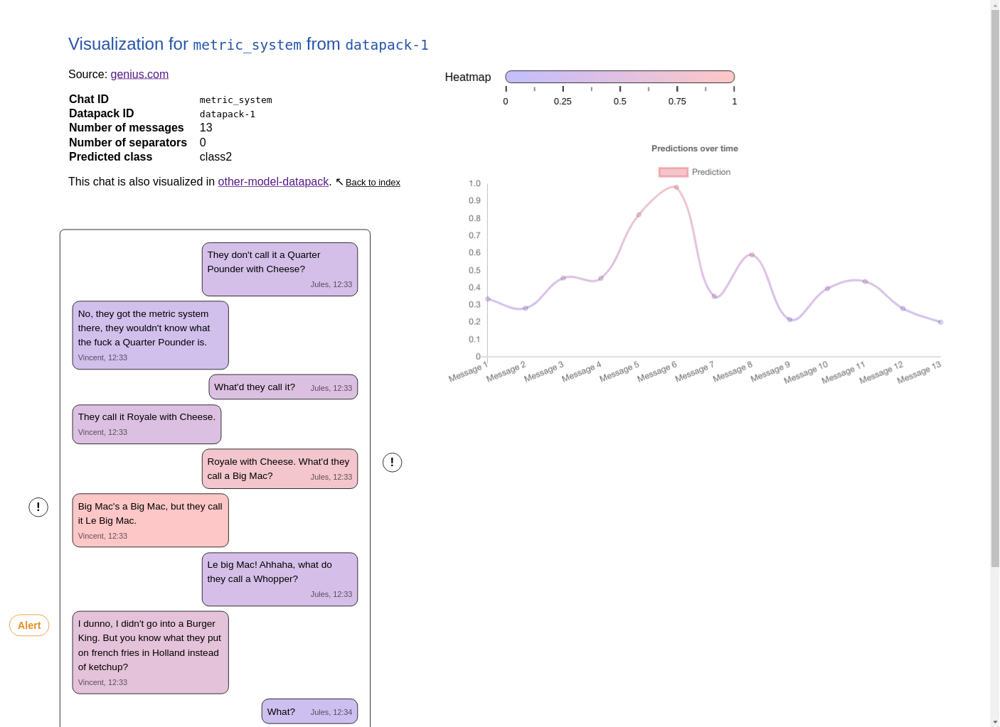

# Chat Visualizer

This is a simple program that hosts a website on your computer to visualize given chat logs. It shows chat messages as a heatmap, for example to visualize the predictions of a machine learning model.

This is very handy when building early warning systems to solve [early risk detection](//early.irlab.org) problems, for example early detection of cyberbullying. With the visualization, one can better understand model predictions. This software was created as part of [a larger project on early sexual predator detection](https://early-sexual-predator-detection.gitlab.io).



The website has a nice user interface that gives an overview of the predictions for the complete chat and allows you to navigate through the chat easily.
It also supports more advanced features such as labelled messages and evaluation metrics.
The websites are generated with handlebars templates. The code is simple and you can easily customize it to your needs.


## Setup

If you haven't already, install the latest node version (e.g. with [nvm](https://github.com/nvm-sh/nvm)). Then run `npm install` in this directory.

## Usage

1. Run `npm start` in this directory.
2. Open `localhost:3000` in your browser.

You can also display *risk annotations* that show the current risk level after each message. If a message has a "prediction" property >= .5, it is considered *risky* and annotated with (!) in the visualization. If 5 of the last 10 messages were risky, an "alert is raised" and the respective message is annotated with (Alert). You can customize this in `options.json` as follows:

```
{
    "riskWindowSize": 10, // the number of previous messages to be considered
    "riskThreshold": 5, // the "skepticism", i.e. how many messages out of the last riskWindowSize messages need to be risky in order to raise a warning
    "showRiskAnnotations": true // whether to show (!) and (Alert) annotations
}
```

## Adding your own data

Visualizations are organized as *Datapacks*. Each datapack is a JSON file that contains a set of chats. The messages in the chat can be annotated with metadata like
- sending time
- author name
- color indication
- labels

The format is as follows:

```javascript

{
    "datapackID": "the_ID_of_the_datapack",
    "description": "Some comments about this pack",
    "generatedAtTime": 1596026756893, // unix timestamp
    "chats": {
        "id_of_the_chat": {
            "description": "Some comments about the chat",

            // If your model is a classifier, you can add the groundtruth
            // labels of your chat and the predicted label of the model here
            "className": "positive",
            "predictedClassName": "negative",

            // appears on the right side in visualizations
            "authorOnRightSide": "Alice",

            // This array stores different content types of the chat.
            // Currently there are
            // - messages (regular text messages) and
            // - separators (displayed as horizontal rules, e.g. to indicate
            //   time has passed between messages)
            // In the future, we might add other types of content like images
            // and voice messages.
            "content": [
                {
                    "type": "message",
                    "author": "Alice",
                    "body": "Lorem ipsum dolor sit amet, consectetur adipisicing elit, sed do eiusmod",
                    "time": 1596025936008,  // unix timestamp

                    // Value between 0 and 1 that controls the message color
                    // Setting this is optional. It could be set as the
                    // probability that the chat up to this message belongs to
                    // the positive class, as assigned by a machine learning
                    // model, for example.
                    "prediction": 0.3256,

                    // optional array of labels for a message
                    "labels": ["bar"],

                    // optional additional HTML class names
                    // The warning class is special and adds an (Alert) bubble
                    // next to the message.
                    "HTMLclassNames": ["warning"]
                },
                {
                    // shows as a horizontal rule
                    "type": "separator"
                }

                // more content…
            ]
        }

        // more chats…
    }
}
```

There are examples available in the `datapacks/` directory where datapacks are stored. To add your own, just create a new JSON file. Nodemon watches this folder for changes, so you don't have to restart it when you update datapacks.

You can add more datapack folders in the `nodemon.json` file. These will also be watched for changes.

## Development

1. Run `npm run devserver` in this directory. This starts the webserver and makes node listen for debugging clients.
2. Open `localhost:3000` in your browser.
3. To debug, open the Node dev tools with the small green Node icon in the regular dev tools

## Future Work

It would be nice to have support for images and voice messages. These can currently be displayed in a hacky way: by adding `` and `<audio/>` tags to message bodies.

The annotations for the graph of predictions over time are hacky and sometimes don't align with the graph perfectly. This should be fixed.

Further evaluation metrics like F1 could be added other than the confusion matrix.

It would also be nice if the website looked better on mobile devices.

## Contributing

Contributions are welcome! :)


## License

This software is licensed under the MIT Liense.
