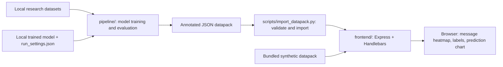

# Dissertation: NLP pipeline and chat visualisation

A unified workspace for Cindy’s dissertation research into early detection of concerning behaviour in chat communications. The project combines a Python NLP/model pipeline with an Express/Handlebars frontend that visualises annotated chat messages and their prediction scores.

## What you can run now

The frontend starts with a **synthetic example** and does not need a trained model, Python ML packages, or research datasets. Its example scores are illustrative; they are not model results or evidence of harmful behaviour.

With a current Node.js LTS release and npm installed:

```sh
npm --prefix frontend ci
npm start
```

Open **http://127.0.0.1:3000**. To restart automatically while developing, run `npm run dev` instead. The server binds only to the local loopback address by default.

## How the two projects connect



This is a **file-based handoff**, not a live model API. The frontend reads already computed scores from JSON; it does not run the NLP model. Its sliding-window alerts are display logic separate from the pipeline’s classifier logic.

## Repository layout

```text
pipeline/                  Original training, annotation and evaluation code
  batch_scripts/           Historical university compute-job scripts
  r_scripts/               Historical analysis scripts
  resources/               Local model runs (not committed)
  datasets/                Local research datasets (not committed)
frontend/                  Express server, views, browser JS/CSS and vendor assets
  datapacks/               Synthetic example + ignored local imports
  legacy_pipeline/         Python files formerly duplicated in the demo repo
scripts/import_datapack.py Data-contract validation and local import
tests/                     Python importer checks
docs/                      Setup notes, data contract, history and provenance
```

The original READMEs remain in `pipeline/README.md` and `frontend/README.md` as historical documentation. Some paths and instructions there describe the original projects. Use this root README and `docs/` for the combined structure.

## Bring model output into the demo

After separately producing an annotated datapack with the historical pipeline:

```sh
python3 scripts/import_datapack.py /absolute/path/to/annotated-output.json
npm start
```

Restart an already running server after importing. The importer validates the frontend’s required structure and the range of prediction scores; it does not anonymise, sanitise HTML, or establish permission to use research data. Use trusted local data only. Imported files are ignored by Git. To replace an existing local import, add `--force`.

See [the data contract](docs/data-contract.md) and [pipeline setup notes](docs/pipeline-setup.md).

## Checks

```sh
npm test
python3 -m unittest discover -s tests -v
```

These check the frontend routes, static assets and datapack handoff without loading ML models. They do not validate dissertation model accuracy or reproduce training results.

## Development

- Frontend: `npm run dev` from this root.
- Model pipeline: run scripts from **inside `pipeline/`** because paths to datasets and model resources are relative to that directory.
- Configuration: export `PORT` (default 3000), `HOST` (default 127.0.0.1), or `DATAPACK_DIR` (an existing folder of JSON datapacks) before starting Node. `frontend/.env.example` documents these names; `.env` files are not automatically loaded.
- Keep model weights, private datasets, virtual environments, generated outputs and credentials outside Git.

## Research status and attribution

This is a research prototype, not a validated safeguarding or diagnostic product. Synthetic demo scores do not indicate real risk. Training requires external model artifacts and datasets that are not included in this source tree.

Both original Git histories are retained as parents of the combined project commit, with original commit IDs and author attribution unchanged. See [migration and provenance](docs/migration.md). Retaining history also retains historical files; this reorganisation is not a history purge.

Original license notices remain in `pipeline/LICENSE.txt`, `pipeline/LICENSE (data).txt`, and `frontend/LICENSE`, plus bundled vendor notices. The demo’s original `package.json` declares GPL while its LICENSE file contains MIT text; that pre-existing inconsistency is recorded here rather than silently changed. See [third-party notes](docs/third-party-notices.md).
